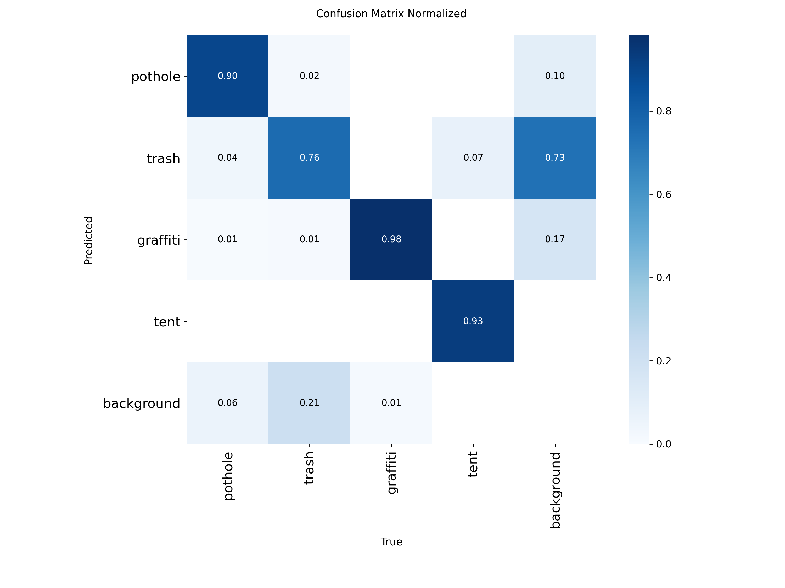

# SafePlaceScan

Computer vision model that flags safety hazards around playgrounds: **potholes, trash, graffiti, and tents/encampments**.

**Live demo:** _add Hugging Face Space link_

## Background

My team built the original SafePlaceScan at the SJSU Cybersecurity & AI Hackathon (3rd of 30). It had to run on an NVIDIA Jetson Nano. I owned the dataset and the on-device deployment.

This repo is my rebuild of the project from scratch, without the Jetson requirement, so it runs on any machine and in the browser. The core idea is the same: no single public dataset covers all four hazards, so the work is in merging several messy datasets into one consistent training set.

Original team: _add teammates_

## How it works

1. **Merge datasets** (`scripts/merge.py`): pulls four public YOLO-format datasets, remaps each one's class names onto 4 unified classes, converts polygon labels to boxes, caps each source so no class dominates, and re-splits everything 80/10/10 with a fixed seed.
2. **Train** (`scripts/train.py`): fine-tunes a pretrained YOLO detector.
3. **Evaluate** (`scripts/evaluate.py`): per-class precision, recall, and mAP on a held-out test set.
4. **Demo** (`app.py`): Gradio web app, upload a photo and see detections.

## Results

_Paste `results/metrics.md` here._



**Dataset:** _paste image/box counts from `data/merged/stats.json`_

## Run it

```bash
pip install -r requirements.txt
cp .env.example .env              # add your Roboflow API key
# fill in configs/datasets.yaml with the datasets you picked
python scripts/download.py
python scripts/merge.py
python scripts/train.py           # use a GPU (Colab works)
python scripts/evaluate.py
python app.py
```

### Training on Google Colab (free GPU)

Runtime → Change runtime type → T4 GPU, then:

```python
!git clone https://github.com/YOUR_USERNAME/safeplacescan.git
%cd safeplacescan
!pip install -q -r requirements.txt
import os; os.environ["ROBOFLOW_API_KEY"] = "your_key"
!python scripts/download.py && python scripts/merge.py
!python scripts/train.py --epochs 50
!python scripts/evaluate.py
from google.colab import files; files.download("weights/best.pt")
```

## Datasets

_List each dataset with link, author, and license (check each page on Roboflow Universe)._

## Repo layout

```
app.py                  Gradio demo
configs/datasets.yaml   sources + class mapping
scripts/                download, merge, train, evaluate
weights/best.pt         trained model
results/                metrics + plots
```
